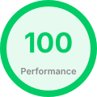

# Breathe Rhythm 🎙️🌊✨

> **«Слова сгорают как холсты, и проступает чистота...»**  
> — *Движок Квантового Вдоха*

`breathe-rhythm` — это интерактивный графический арт-манифест, визуальный Canvas-движок и цифровая инсталляция, исследующая ритм человеческого дыхания сквозь призму живой поэзии.

Проект превращает статичные строки стихов в динамическую световую SPA-вселенную, где текст рождается, затухает, уходит в архивную тень, рассыпается на искры, мерцает пайетками, пульсирует в такт слогам и взрывается квантовыми вспышками частиц строго в ритме знаков препинания и заложенных поэтических пауз.

https://okudakaeva.github.io/breathe-rhythm/

   

---

## 🎭 Архитектурная Драматургия и Магия

Движок разработан по канонам абсолютного программного пуризма — на чистых стандартах **Vanilla JS / TypeScript** и нативных технологиях **W3C Web Components** без капли фреймворков (React, Vue, Angular), обеспечивая попиксельную микросекундную отрисовку кадра прямо на «железе» браузера:

*   **Нативные Веб-Компоненты (Custom Elements)**: Архитектура построена на полной изоляции. Графический хаб `<breathe-rhythm>` и глупые полиморфные компоненты кнопок `<ui-button>` и иконок `<ui-icon>` абсолютно независимы. Они не импортируют друг друга и связаны снаружи через реактивный клей событий (`engine-state-change`).
*   **Инкапсуляция Тени и Пробитие Границ**: Интерфейс пульта управления полностью закрыт в **Shadow DOM** и использует механизм **`<slot>`** для виртуальной проекции иконок. При этом неоновый киберпанковый дизайн не зашит в JS, а изящно управляется из внешнего CSS-файла через нативный браузерный механизм **`::part()`**.
*   **Реактивный Темпоральный Конвейер (`rAF + deltaTime`, `AbortController` и Page Visibility)**: Жизненный цикл перформанса синхронизирован с частотой обновления экрана (`requestAnimationFrame` с защитой от скачков при сворачивании вкладки и автопаузой по `visibilitychange`) и управляется единым рубильником `AbortController`. Нажатие на паузу замораживает рождение новых букв, но позволяет искрам `{flash}`, затуханию прошлых строк и активным сегментам естественно доиграть до точки покоя. При возвращении с паузы длинные межстрочные задержки мягко сокращаются вдвое, сохраняя живое дыхание текста.
*   **Философия Лентяя (JS Generators)**: Движок избавлен от костылей с подсчётом напечатанных символов. Нативный итератор `scene.next()` сам удерживает в памяти контекст кадра, текущую строку и задержки, пробуждаясь ровно с той миллисекунды, где его настигла пауза.
*   **Модульная Хореография Эффектов (`BREffects`)**: Слой визуальных эффектов изолирован от рендерера и разделён по физике поведения на 4 статических модуля: пиксельные маски (`BRMaskEffects`), потоки частиц (`BRParticleEffects`), слоговой ритм (`BRSyllabicEffects`) и посимвольные/спрайтовые трансформации (`BRSimpleEffects`).
*   **Изолированный Холст, HiDPI и Гигиена VRAM (HTML5 Canvas)**: Рендерер `BRRenderer` автоматически адаптируется под `devicePixelRatio` для бритвенной чёткости шрифтов и неонового свечения на Retina-экранах. Кэширование метрик текста, предвычисление графов созвездий и детерминированная утилизация ресурсов (`disposeSegment`) мгновенно освобождают offscreen-канвасы спрайтов (`glowCanvas`) и массивы частиц из видеопамяти сразу после отработки сегмента, обеспечивая стабильные 60 FPS без утечек.

---

## ✨ Поэтический Синтаксис и Арсенал Эффектов

Парсер `BRParser` превращает обычный текст стихотворения в партитуру дыхания, понимая знаки препинания, ручные паузы, сценические команды и 20 художественных тегов.

### Базовая разметка ритма
*   **Знаки препинания**: Автоматические микропаузы на запятых, тире, двоеточиях, окончаниях фраз и многоточиях.
*   **`[ms]`** — Точная дыхательная пауза в миллисекундах (например, `Слова[300] сгорают`). Работает как между словами, так и **внутри** любых художественных тегов, пропорционально деля время анимации.
*   **`{flash}`** — Сценическая команда квантовой вспышки частиц в конце строки.

### Параметры тегов (`<tag:param>`)
*   Для **несиллабических тегов** (`mask`, `particles`, `simple`) параметр задаёт точную продолжительность анимации в миллисекундах: `<snow:2500>Тихий снег...</snow>`.
*   Для **силлабических тегов** (`syllabic`) параметр задаёт номер ударного слога (начиная с `1`), на котором срабатывает акцентная пауза и вспыхивает вся фраза: `<pulse:3>Полыхает пусть!</pulse>`. Без параметра фраза бежит ровным пульсом и вспыхивает целиком на самом последнем слоге.

### Палитра из 20 художественных тегов

| Категория | Тег | Визуальная механика |
| :--- | :--- | :--- |
| **Текстовые маски**<br>*(BRMaskEffects)* | `<sand>` | Сборка контура слова из хаотичных песчинок. |
| | `<fireflies>` | Рой биолюминесцентных светлячков, собирающий фразу слева направо. |
| | `<glitter>` | Пайетки и искры, переливающиеся внутри букв при посимвольной печати. |
| | `<breeze>` | Мягкий ветер слева, приносящий рой частиц в контур неподвижного слова. |
| | `<frost>` | Морозная кристаллизация, разрастающаяся от случайных очагов замерзания. |
| | `<constellation>` | Звёздная карта с мерцающими вершинами и светящимися нитями между ними. |
| **Системы частиц**<br>*(BRParticleEffects)* | `<wind>` | Боковой порыв ветра с аэродинамическим наклоном букв и вихрем пыли. |
| | `<embers>` | Тлеющие искры костра, улетающие вверх от горячих букв. |
| | `<snow>` | Тихий кружащийся снегопад / падающий пепел сквозь строку. |
| | `<sparks>` | Резкие короткие электрические разряды от контура букв. |
| | `<dandelion>` | Невесомая пыльца, срывающаяся вправо и вверх с напечатанного слова. |
| **Слоговой ритм**<br>*(BRSyllabicEffects)* | `<pulse>` / `<pulse:N>` | Слоговое скандирование с упругим ударом и финальной вспышкой. |
| | `<fire>` / `<fire:N>` | Тлеющие слоги с восходящими языками пламени над строкой. |
| | `<ripple>` / `<ripple:N>` | Волна линзы и круги на воде, бегущие по направлению чтения. |
| | `<sparkle>` / `<sparkle:N>` | Россыпь глиттер-пайеток на текущем активном слоге. |
| | `<orbit>` / `<orbit:N>` | Спокойные светлячки, парящие по орбите вокруг активного слога. |
| **Простые и оптические**<br>*(BRSimpleEffects)* | `<water>` | Плавное течение слева направо с водными шлейфами по числу слогов. |
| | `<echo>` | Посимвольное акустическое послезвучие с тремя затухающими импульсами. |
| | `<mirror>` | Посимвольная печать с перевёрнутым отражением под строкой. |
| | `<grow>` | Посимвольный динамический рост букв от миниатюры до полного веса. |

---

## 🎮 Пульт Управления Сценой

Инсталляция полностью автономна и управляется реактивными геттерами состояний:
*   `isReady` — Квантовые данные стихов успешно загружены, холст готов к перформансу.
*   `isRunning` — Поток времени запущен, текст рождается на экране в реальном времени.
*   `isPaused` — Время заморожено на полуслове, генератор удерживает контекст кадра, пока физика частиц мягко затухает.
*   `isFinished` — Стих дочитан до последней капли. Последняя строка уходит в тень, и всё полотно одновременно и плавно заливается белым неоновым свечением.

---

## 🚀 Быстрый старт

Проект написан на TypeScript и компилируется в нативные ES-модули. Для запуска перформанса локально выполните следующие шаги:

1. **Клонируйте репозиторий** и перейдите в папку проекта арт-инсталляции:
   ```bash
   cd breathe-rhythm
   ```

2. **Установите зависимости** (требуется Node.js для компилятора TypeScript):
   ```bash
   npm install
   ```

3. **Скомпилируйте исходный код** (компилятор tsc пересоберет `.ts` в `.js` с сохранением архитектуры модулей):
   ```bash
   npm run build
   ```

4. **Запустите проект** через любой локальный статический сервер (например, расширение *Live Server* в VS Code или `npx local-server`) и откройте `index.html` в браузере.

---

## 🌌 Поэтический Роадмап (Впереди — Самое интересное)

Ядро движка и библиотека из 20 текстовых эффектов полностью готовы. Впереди — расширение сценического пространства:
*   **Фоновые атмосферы сцены**: Натуралистичные погодные и световые слои на заднем плане — вертикально стекающие капли дождя по стеклу и расходящиеся круги на луже.
*   **Анимированный слоговой курсор**: Покадровый печатный курсор-персонаж (включая танцующую фигурку, шагающую по слогам в такт рэп-стихам).
*   **Нативный SPA-Роутер и Клавиатура**: Компонент `<ui-router>` на базе `History API` для переходов между стихами по прямым URL, а также горячие клавиши (`Space`, `R`, стрелки).
*   **Инсталляционный Автоплей**: Режим бесконечного чтения с автоматическим выбором произведений и переключателем автоперехода для медитативного созерцания финала.

*Да здравствует визуальная поэзия! Да здравствует свободный и чистый веб-стандарт!*
